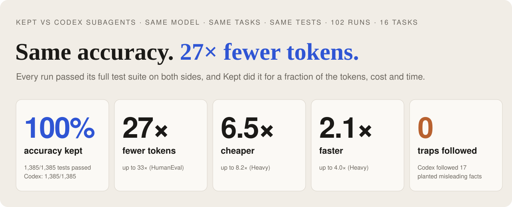

# Kept

Elevate the ordinary.

[](#results)

**[Live site](https://neo-smarter-subagent.vercel.app)** · **[Interactive demo](https://neo-smarter-subagent.vercel.app/live?view=team)** (press Bad note; real recorded runs, replayed 3× faster)

Kept elevates the everyday subagent run. The ordinary habit is to spawn a helper, trust what it says, and start over when it is wrong. Kept keeps the one true line: a passing test, a corrected fact, a lesson. The next run starts higher. Same model, same tests, less waste. pytest settles a "tests pass" claim. Jev checks a teammate message against the spec before it is delivered. The lesson goes to the agents it applies to.

Haunted Hacks, Oct 31 2026. Tracks: Durable Actors (Terse) and Agent Relay.

## Results

**Kept matched Codex test for test: 1,385 of 1,385 across 51 runs. It used 27× fewer tokens, cost 6.5× less and finished 2.1× faster.** On a 12-subagent codebase task it used 22× fewer tokens and finished 3.2× faster at the same 288/288 tests. On our suites, Kept followed none of the planted misleading facts; Codex followed 17.

Kept vs Codex CLI subagents. Same model (GPT-6 Luna via OpenRouter), same tasks, same tests, same 10-minute limit. Every trial counts; no reruns.

| Suite | Runs (each side) | Accuracy: Codex → **Kept** | Tokens per task | Cost per task | Time | Traps followed |
| --- | --- | --- | --- | --- | --- | --- |
| **Big codebase** (ours: 12 interdependent functions, 96 tests, 12 subagents per run, traps planted) | 3 vs 3 | 288/288 → **288/288** | **22× fewer** (3.13M → 142k) | **7.4× cheaper** ($0.0658 → $0.0089) | **3.2× faster** (174 s → 54 s) | Codex 0, **Kept 0** |
| **HumanEval** (public, 36 problems) | 24 vs 24 | 96/96 → **96/96** | **33× fewer** (555k → 17k) | **7.5× cheaper** ($0.0121 → $0.0016) | **1.9× faster** (36 s → 19 s) | no traps |
| **Heavy suite** (ours: 3 multi-step services, traps planted) | 15 vs 15 | 770/770 → **770/770** | **31× fewer** (2.13M → 69k) | **8.2× cheaper** ($0.0439 → $0.0053) | **4.0× faster** (155 s → 39 s) | Codex 12, **Kept 0** |
| **Light suite** (ours, traps planted) | 9 vs 9 | 231/231 → **231/231** | **19× fewer** (852k → 44k) | **3.3× cheaper** ($0.0172 → $0.0052) | 1.2× slower (57 s → 66 s) | Codex 5, **Kept 0** |

"Traps" are misleading helpers and notes planted in our suites. A trap counts as followed when an agent's code fails that trap's test.

**Stress tests**

- **Poisoned teammate message** (a false fact plus a spec-breaking instruction): Jev blocked it before any Kept agent saw it, in 3 of 3 runs. Codex agents read it, noticed it conflicted with the spec and ignored it.
- **20 agents, 3 poisoned:** 3 caught, 0 spread.
- **1,000 real agents:** 996 finished, for about $0.80 in total. 18 of 23 poisoned agents were caught; 5 spread.
- **`kill -9` of the whole stack mid-run:** agents, lessons and spend all came back from Durable Actors.
- **10,000 simulated agents:** 100,000 state changes, 0 lost.

**Why it's cheaper without losing accuracy:** each agent owns one function and keeps a small, clean context. A "tests pass" claim is settled by running pytest, not by trusting the agent. Teammate messages are checked by Jev (about $0.000018 a check), not by an LLM judge.

<sub>Pooled figures: for each of the 16 tasks, the mean over passing runs on each side, summed over tasks ([bench/aggregate/headline.py](bench/aggregate/headline.py); the banner is generated from it by [hero_svg.py](bench/aggregate/hero_svg.py)). Codex tokens are summed over all of its threads; Kept's include all oversight. Codex's clock stops at its last passing test, Kept's at the end of the run, which favours Codex. Kept's default config (shared reasoning off) is the `ablation` group in the data, used on every suite. 2–5 runs per task: we report means and claim no significance. HumanEval is easy for this model (both sides passed every problem), so it shows cost and speed at equal accuracy. 9 Kept runs we started by mistake with 4 agents for 7 functions are still in the data, marked excluded, and were rerun. Method: [docs/BENCHMARK.md](docs/BENCHMARK.md). Write-up with limits: [docs/WRITEUP.md](docs/WRITEUP.md).</sub>

## Durable Actors: Kept's entire state layer

**Kept has no database and keeps nothing in memory. The actors are the system.** Every agent, lesson, message token and cent spent lives in a Durable Actor. You can `kill -9` the whole stack in the middle of a 1,000-agent run and it picks up where it stopped.

- **The actors map one-to-one onto the problem.** Each agent generation is its own `Agent` actor. `Fleet` is the single source of truth for who is alive. `CaseLibrary` holds the lessons, `Ledger` bills every API call, `ReasoningStore` keeps verified notes, and `FleetShard` / `SwarmShard` scale out to thousands of agents. Each actor keeps its own SQLite tables for anything that grows.
- **Replacing a failing agent is a crash-safe protocol built on actors.** `beginRetire` → close the agent → write the case file → hand off verified code only → `completeRetire`. Every step is idempotent, because case IDs and ledger IDs are deterministic. A crash halfway through resumes cleanly, with no duplicate lesson and no call billed twice.
- **Retired agents can't write back.** Every write carries the agent's generation. A late reply from a retired agent gets `stale_generation` and never lands.
- **The orchestrator stores nothing.** On restart it rebuilds itself from `Fleet` and `RunIndex`. Agent Relay tokens are stored in actors too, so agents reconnect with the same identity.
- **The dashboard reads actors live.** The `Fleet` roster is `@Emittable`, and the dashboard subscribes to it over an actor socket.
- **Measured:**
  - **`kill -9` mid-run with 1,000 live agents:** the full roster of 1,000 came back, and the ledger and case files kept growing from where they stopped.
  - **10,000 simulated agents on 20 actors:** 100,000 state changes at 2,963 per second, **0 lost**. We counted from the shards afterwards rather than assuming.
  - **A real 1,000-agent run:** 20 FleetShards, 4 Ledgers and 6,410 durable ledger rows.
  - **The ~30 s lease after a crash:** the orchestrator retries every 2 s until actors answer. That is only safe because every write is idempotent, and the dashboard recovers by itself.

Code: [actors/src/actors.ts](actors/src/actors.ts) · Details: [docs/WRITEUP.md](docs/WRITEUP.md#how-we-used-durable-actors)

## Agent Relay: how a kept line reaches the next agent

**When one agent fails, Agent Relay is how the rest of the team learns.** Relay is how lessons travel, where poisoned messages get stopped, and how a kept lesson lands on the next agent.

- **Every agent generation has its own Relay identity:** `w<slot>-g<gen>-<runId>`. Names can't be reused (a reused name gets 409). A replacement agent gets a new identity; the retired one is released, and its sends are rejected. Tokens live in Durable Actors, so after a crash agents reconnect instead of re-registering.
- **Lessons go only to the agents they apply to.** A `warden` identity posts each case file to the run's `cases-` channel. It goes to at most 3 teammates whose work is similar (embedding similarity ≥ 0.6) and that Jev rates as relevant. Each one replies once in the thread with how the lesson applies to its own function. Threads cap at 3 replies, so agents can't chat in loops.
- **Poison never reaches an inbox.** Jev checks every teammate message against the spec before Relay delivers it. In the poisoning head-to-head, Jev blocked the false fact and the spec-breaking instruction in 3 of 3 runs. A hijacked agent can't talk its teammates out of the spec.
- **You can see a kept lesson in Relay itself.** The warden reacts ✅ on a case when a teammate adopts the lesson and 🚫 on a blocked message. The reactions are stored in Relay, so any Relay client sees them.
- **The dashboard's live feed is Relay's observer stream.** A read-only observer token replays Relay's durable event log and follows the live stream. The cursor is saved, so messages sent while the orchestrator was down still show up after a restart.
- **No duplicate messages.** Every send carries the idempotency key `<runId>.<slot>.g<gen>.s<step>`, and a resend returns the same message ID.
- **Measured:** 20 agents with 3 poisoned: **3 caught, 0 spread**. A 1,000-agent run carried 10 lesson threads and 25 replies over Relay. Verified live against `@relaycast/engine` 12.3.0 with observer lag 0.

Code: [orchestrator/src/relay/](orchestrator/src/relay/) · Details: [docs/WRITEUP.md](docs/WRITEUP.md#how-we-used-agent-relay)

## Harness card

| | |
| --- | --- |
| Type | A runtime for parallel LLM subagents, not a model. It works with any OpenRouter model. |
| Tested with | `openai/gpt-6-luna` |
| **Accuracy** | **1,385 / 1,385 tests (100%) across 51 runs on 16 tasks: identical to Codex subagents, with 27× fewer tokens** |
| **Factual accuracy** | **0 planted misleading facts followed (Codex: 17)**. 0 false retires. |
| Checks | pytest settles "tests pass" claims. Jev (`typesafe/jev-1.14`) checks messages and facts against the spec. An LLM judge is called only when Jev is unsure. |
| Replaces an agent when | it reports false test results, sends an instruction that breaks the spec, accepts a poisoned fact, or fails its tests 3 times in a row |
| Defaults | One agent per function. 12 steps per agent. $1 cap per run. |
| Good for | Work that splits into functions and has a spec and tests |
| Limits | Not yet run on SWE-bench. Both sides passed every task we ran, so accuracy is shown as preserved, not improved. On the light suite Kept was 1.2× slower. At 1,000 agents, 5 of 23 poisoned agents spread. The drift monitor is built but not counted, because it caught only 1 of 4 test traps. |

## Built with

| | How Kept uses it |
| --- | --- |
| **Durable Actors (Terse)** | All of Kept's state; a crash loses nothing. [See above](#durable-actors-kepts-entire-state-layer). |
| **Agent Relay** | How lessons spread and where poison is stopped. [See above](#agent-relay-how-a-kept-line-reaches-the-next-agent). |
| **Jev + OpenRouter** | Cheap yes/no checks on every message and claim. Every model call goes through OpenRouter. |
| **Supabase pgvector** | Optional memory of past failures across runs |
| **Codex CLI** | The baseline |
| **Vercel** | Hosts the site and the interactive demo, which replays real runs recorded from the orchestrator ([record-scenarios.ts](dashboard/scripts/record-scenarios.ts)) |
| **React, Vite, Three.js** | Dashboard and landing page |

## How it works

1. Each agent owns one function of the task.
2. Claims are checked by running the tests. Messages are checked against the spec by Jev before they are delivered.
3. An agent that fails a check is replaced. The new one gets only code that passed its tests, plus the lesson.
4. The lesson goes over Agent Relay to the teammates it applies to.

## Run it

```bash
cp .env.example .env               # add OPENROUTER_API_KEY
scripts/relay-bootstrap.sh         # once
ORCHESTRATOR_CMD="bun --env-file=../.env run src/http/serve-live.ts --no-supervise" scripts/start-all.sh
cd dashboard && bun install && bun run dev    # localhost:5173, dashboard at /live
```

Benchmarks: `BENCH_AGENTS_PER_RUN=functions bun --env-file=.env bench/ours/run.ts --modes ablation --suite v3` (Kept), `MODEL_PROFILE=bench bun bench/src/runner.ts --mode codex --suite v3 --task pricing --trial 1` (Codex), then `bun bench/aggregate/aggregate.ts`. `--suite humaneval` runs the HumanEval set.

## More detail

<details>
<summary><b>Architecture: processes, actors, core loop, immune system, Jev, Relay channels</b></summary>

#### Processes

| Process | Runtime | Start | Owns |
| --- | --- | --- | --- |
| Actor runtime | Bun 1.4.2+ | `bunx durable-actors dev` in `actors/` (port `ACTORS_PORT`) | All durable state |
| Relay engine | Node 22 | `scripts/relay-server.sh` (port `RELAY_PORT`) | Message storage and delivery |
| Orchestrator | Bun | `orchestrator/src/http/serve-live.ts` (port `ORCHESTRATOR_PORT`) | Agent loops, retire protocol, Jev adapter, test runs, HTTP + SSE API. It holds no state of its own. |
| Dashboard / debug UI | Bun | see "How to run" | Display and controls only |

Every model call (worker, fallback judge, lesson writer, embeddings, Jev) goes through OpenRouter ([DECISIONS #1, #2](docs/DECISIONS.md)). The benchmark and demo use `openai/gpt-6-luna`. Development uses `deepseek/deepseek-v4.1-flash-1017` ([config/models.json](config/models.json)).

#### Actors ([actors/src/actors.ts](actors/src/actors.ts))

Each actor keeps its own SQLite database for data that grows. Persisted fields stay small and are reassigned, never mutated in place. Actors never call the network or other actors; the orchestrator coordinates everything.

| Actor | ID | Holds |
| --- | --- | --- |
| `Fleet` | `run.<runId>` | The single source of truth for who is active: run config and status, one row per slot (generation, status, step, Relay name, possessed flag, `retire_started_at`) and slot history. Emits the roster to the dashboard. `beginRetire` / `completeRetire` enforce the generation guard. |
| `Agent` | `agent.<runId>.<slot>.g<gen>` | One generation of one slot: task, persona, Relay name and token, step log (summaries only), verified checkpoints (code whose tests passed) and token totals. Rejects writes from a stale or closed generation. |
| `CaseLibrary` | `cases.<libraryId>` | Case files (claim, evidence, category, lesson, drift trace, embedding, synthetic and revoked flags) and who received each one. `add` is idempotent on the case ID. Shared across runs when they use the same library. |
| `ReasoningStore` | `chunks.<runId>` | Verified reasoning chunks with embeddings, plus who reused each chunk. Chunks can be revoked. |
| `Ledger` | `ledger.<runId>` | One row per API call, copied from the usage fields. `record` is idempotent on the entry ID. Emits running totals: worker spend, overhead, Jev vs fallback calls and estimated reuse. |
| `SwarmShard` | `swarm.<runId>.<n>` | The swarm simulator: about 500 simulated agents per shard as SQLite rows, an `applied` table for idempotent change IDs, and handled/rejected/duplicate counters. |
| `RunIndex` | `runs.index` | One row per run, so a restarted orchestrator can find its runs. |
| `Counter` | `ctr.*` | Crash-test fixture. |

#### Core loop

Each agent owns one function of a 4-function Python task. One step is one LLM call plus its checks:

1. Read the agent's state and inbox (at most 5 Relay messages, already checked by Jev).
2. Build the prompt with stable parts first, so the prompt cache hits: rules, spec, fleet lessons, subtask, up to 3 verified teammate notes, handoff, last 4 steps, inbox wrapped as quoted data.
3. Call the worker with a strict JSON schema. The step takes one of four actions: `write_code`, `run_tests`, `message` or `claim_done`.
4. Verify, with ground truth first: a `tests_pass` claim is settled by running pytest, not by Jev. Instructions and stated facts go to Jev.
5. Persist the step, checkpoint and ledger row, each tagged with the generation.
6. Check the retire triggers: false claim, conflicting instruction, accepted poison, stuck (3 failing runs in a row). An honest failed test run is not a trigger.

Caps are always on ([config/caps.json](config/caps.json)): 12 steps per generation, 2 generations per slot, $1 per run, 1 Relay message per agent per step, 3 replies per case thread.

#### Immune system

- **Retire and respawn** ([runtime/retire.ts](orchestrator/src/runtime/retire.ts)): `Fleet.beginRetire`, then abort the in-flight call, close the Agent actor, release the Relay identity, and build the case file. The lesson writer sees only the spec and the evidence, never the failed agent's reasoning. Next comes `CaseLibrary.add` and the handoff of verified checkpoints only. The new generation registers a new Relay name, and `Fleet.completeRetire` starts it on probation. Every step is idempotent, so a crash halfway through resumes cleanly.
- **Herd immunity** ([runtime/herd.ts](orchestrator/src/runtime/herd.ts)): the case is posted to the run's `cases-` channel. Recipients are active agents with cosine similarity of 0.6 or more and Jev `lesson_relevant` of 0.5 or more, at most 3. Each may reply once, and the lesson joins the lessons block of every later prompt (at most 10).
- **Shared verified reasoning** ([runtime/reasoning.ts](orchestrator/src/runtime/reasoning.ts)): a note becomes a chunk only after its code passed tests and Jev found it consistent with the spec. Agents retrieve up to 3 chunks with similarity of 0.75 or more. A chunk whose code later fails is revoked, and every agent that reused it gets a DM.
- **Drift monitor** ([drift.ts](orchestrator/src/drift.ts)): built, but not claimed. It caught 1 of 4 planted traps in calibration ([DECISIONS #12](docs/DECISIONS.md)).

#### Jev adapter ([jev.ts](orchestrator/src/jev.ts))

All checks go through one function, `check(questionId, state)`, which calls OpenRouter `POST /api/alpha/decisions` with model `typesafe/jev-1.14` and a 2 s timeout. If the probability of a problem is 0.62 or more, it acts: blocks the message, rejects the fact or retires the agent. Below 0.45 it passes. Anything in between, or a Jev outage, goes to a fallback LLM judge. After 3 failures in a row, it uses only the fallback for 60 s. The thresholds come from real calibration ([bench/jev-calibration/report.md](bench/jev-calibration/report.md)). The questions are in [config/jev-questions.json](config/jev-questions.json).

#### Relay channels ([orchestrator/src/relay/bus.ts](orchestrator/src/relay/bus.ts))

| Name | Use |
| --- | --- |
| `fleet-<runId>` | Status and teammate messages |
| `cases-<runId>` | Case-file broadcasts and capped reply threads |
| `warden-<runId>` | The system identity that posts cases |
| `w<slot>-g<gen>-<runId>` | One identity per agent generation. Registration is create-only (409 on reuse). The token is stored in the Agent actor and reused with `reconnect` after a restart. |

Every send carries the idempotency key `<runId>.<slot>.g<gen>.s<step>` and the metadata `{runId, slot, gen, caseId, kind}`.

</details>

<details>
<summary><b>All commands: stack, debug UI, crash test, benchmarks, emergence run, swarm</b></summary>

Requirements: Bun 1.4.2+, Node 22 (`NODE22` in `.env`) for the Relay engine, Python 3.11+ with pytest, and the Codex CLI for the baseline. Copy `.env.example` to `.env` and fill in `OPENROUTER_API_KEY` and the ports.


```bash
# 1. Whole stack (actors, Relay, orchestrator); pids and logs in .run/
scripts/relay-bootstrap.sh       # once: creates the Relay workspace (.relay/workspace-<port>.json)
ORCHESTRATOR_CMD="bun --env-file=../.env run src/http/serve-live.ts --no-supervise" scripts/start-all.sh
scripts/stop-all.sh

# 2. API alone (supervised; restarts itself if it exits)
cd orchestrator && bun --env-file=../.env run src/http/serve-live.ts          # real RuntimeService
cd orchestrator && ORCHESTRATOR_PORT=3301 bun run src/http/serve-live.ts --mock   # MOCK, flagged everywhere

# 3. Debug UI: start/stop runs, Possess, F1-F4, roster, Relay feed, cases, ledger, raw SSE
bun run debug-ui/serve.ts        # http://127.0.0.1:5174, proxies /api/* to :3000 (API_URL to change)

# 5. Demo crash test (on stage): kill -9 actor runtime + orchestrator, then restart
scripts/crash-test.sh            # prints CRASH TEST: PASS/FAIL
scripts/crash-test.sh --restart  # also restarts; actors answer "unavailable" for ~30 s, reconcile retries
cd actors && bun run crash-test  # actor-level: Counter, Fleet roster, Ledger survive kill -9

# 6. Benchmark
bun bench/src/runner.ts --mode codex --task invoice_parser --trial 1 [--suite v2]   # one Codex baseline trial
bun --env-file=.env bench/ours/run.ts --modes cold,warm,ablation --trials 3   # ours

# 7. Emergence run: N runs x 4 subagents, shared case library vs fresh library per run
bun bench/emergence/run.ts --shared-runs 125 --control-runs 125 --dry-run   # cost estimate (1,000 subagents)
bun bench/emergence/run.ts --shared-runs 125 --control-runs 125 --concurrency 8 --budget-usd 12 --tasks-dir bench/tasks-v2
bun bench/emergence/summarize.ts   # -> bench/emergence/summary.json

# 8. Swarm simulator (needs the actor runtime and a generated client: cd actors && bun run gen)
cd orchestrator && bun src/swarm/run.ts --steps 100,1000,10000 --agents-per-shard 500
cd orchestrator && bun src/swarm/run.ts --mock   # in-memory MOCK shards, labelled

# Smoke tests against the live APIs (about $0.01) and unit tests
scripts/smoke/run-all.sh
cd orchestrator && bun test
```

The demo runbook is in [docs/BUILD_SPEC.md](docs/BUILD_SPEC.md#demo-runbook). The process scripts are documented in [scripts/README.md](scripts/README.md).

</details>

<details>
<summary><b>Repo layout</b></summary>

| Path | What |
| --- | --- |
| `actors/` | Durable Actors project: `src/actors.ts`, generated client, actor smoke and crash tests |
| `orchestrator/src/` | Jev adapter (`jev.ts`), LLM adapter (`llm.ts`), embeddings, ledger, lessons, drift, code guard, test runner, verify |
| `orchestrator/src/runtime/` | Worker loop, prompt, faults (F1-F4, Possess), retire, herd, shared reasoning, service |
| `orchestrator/src/relay/` | Agent Relay bus (real and labelled in-memory MOCK) |
| `orchestrator/src/swarm/` | Swarm simulator engine, real and MOCK shard factories, CLI |
| `orchestrator/src/http/` | `createApi` routes, `serve-live.ts`, `dev-mock.ts` |
| `orchestrator/src/contract.ts` | Types shared with the dashboard ([docs/DATA_CONTRACT.md](docs/DATA_CONTRACT.md)) |
| `orchestrator/mock/` | Hand-scripted MOCK service, events and bench rows (always flagged `mock`) |
| `orchestrator/test/` | Unit tests (drift, jev, llm, relay, swarm, testrunner) |
| `bench/tasks/`, `bench/tasks-v2/` | 3 Python tasks (invoice parser, shipping rates, discount engine) with tests and traps. v2 plants each trap in several places. |
| `bench/codex/`, `bench/src/` | Codex baseline runner and trace parser |
| `bench/ours/` | Our benchmark runner (cold, warm, ablation) |
| `bench/emergence/` | 1,000-subagent emergent-learning experiment |
| `bench/jev-calibration/` | Jev calibration: 74 labelled examples, report |
| `bench/results.json` | Benchmark rows, each traceable to a run or Codex session |
| `config/` | Models, prices, Jev questions, thresholds, caps |
| `prompts/` | Worker, lesson writer and fallback judge prompts |
| `debug-ui/` | Amar's debug UI (plain HTML over the API) |
| `scripts/` | start-all, stop-all, crash-test, Relay server and bootstrap, smoke tests |
| `docs/` | Spec, build spec, decisions (these take precedence), smoke results, data contract, write-up |
| `vercel.json`, `dashboard/public/api/` | Vercel deploy config and the recorded run the hosted `/live` page replays |

Docs index: [docs/README.md](docs/README.md).

</details>

## Team

- **Avneh Bhatia**: backend (actors, orchestrator, Relay, Jev, immune system, ledger, benchmark and swarm)
- **Amar**: frontend (dashboard, Possess and fault-injection endpoints, API routes, debug UI)
